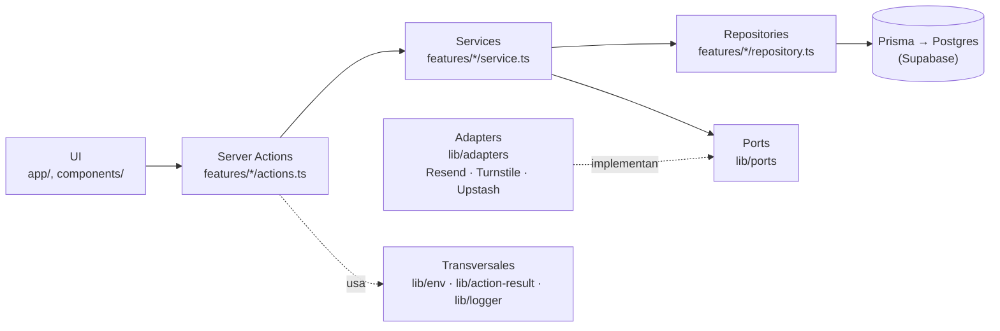
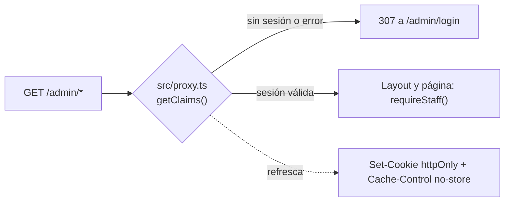
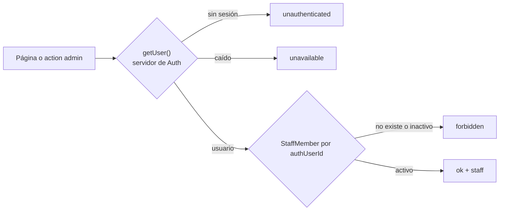
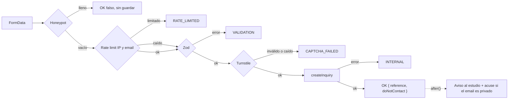
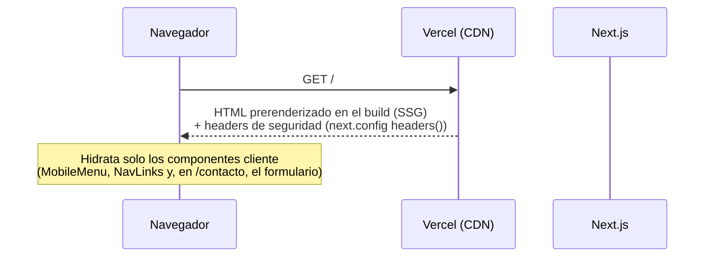

# Arquitectura

Resumen de la arquitectura vigente. La fuente de verdad es [`SPEC.md`](SPEC.md) §6; este documento explica cómo está armado **hoy** el código y hacia dónde va. Se actualiza en cada tarea que cambie estructura o flujos.

Última actualización: F2-08 (22/11/2026). El sitio público de la Fase 2 está implementado; el formulario, la base y los mails llegan en F3.

## Principios

1. **Server-first.** Las páginas públicas se renderizan de forma estática (SSG). Solo el formulario y el panel admin son dinámicos. El JavaScript de cliente se limita a lo interactivo (hoy: el menú mobile y la marca de página actual).
2. **Capas con dependencias hacia adentro.** UI → Server Actions → Services → Repositories / Ports. Los services no conocen Next, Prisma ni SDKs ([ADR 0001](adr/0001-arquitectura-en-capas-por-feature.md)).
3. **Ports & adapters** para servicios externos (mail, captcha, rate limit, reloj): se cambian o se simulan en tests sin tocar la lógica.
4. **Un tenant por instalación:** cada estudio cliente tiene su deploy, su base y su configuración ([ADR 0003](adr/0003-un-tenant-por-instalacion.md)).
5. **Configuración y contenido separados del código:** los datos del estudio viven en `src/config` y `src/content`.
6. **Seguro por defecto:** validación con Zod en el servidor, secretos solo del lado del servidor, headers de seguridad en todas las rutas y logs sin datos personales.

## Capas

| Capa           | Responsabilidad                                                                                   | Regla clave                                      |
| -------------- | ------------------------------------------------------------------------------------------------- | ------------------------------------------------ |
| UI             | Páginas, layouts y componentes. Server Components por defecto.                                    | `"use client"` solo si hay interactividad.       |
| Server Actions | Parsean el input con Zod, chequean auth, llaman al service y devuelven `ActionResult<T>`.         | Sin lógica de negocio.                           |
| Services       | Reglas de negocio puras. Reciben repos y ports por parámetro.                                     | Nunca importan Prisma ni SDKs.                   |
| Repositories   | Acceso a datos.                                                                                   | Único lugar que toca Prisma.                     |
| Ports/Adapters | Interfaces de servicios externos y sus implementaciones.                                          | Los SDKs solo se importan en los adapters.       |
| Auth (F4)      | `requireStaff()` en `features/auth/dal.ts`, en **cada** página y action del admin.                | El `proxy` es solo una primera barrera.          |

## Estructura: qué existe hoy y qué viene

| Ruta                          | Estado      | Contenido                                                                                      |
| ----------------------------- | ----------- | ---------------------------------------------------------------------------------------------- |
| `src/app/layout.tsx`          | ✅ F1-07    | Layout raíz: `lang="es-AR"`, fuentes (`next/font`), metadata base.                             |
| `src/app/globals.css`         | ✅ F1-07    | Tokens de diseño (SPEC §11.1).                                                                 |
| `src/app/(public)/`           | ✅ F2-07    | Layout público y las páginas de FR-01. El formulario de Contacto llega en F3.                  |
| `src/app/admin/`              | 🟨 F4       | ✅ `layout.tsx` común (`noindex`, encabezado propio), `(protected)/layout.tsx` con `requireStaff()` y la barra de sesión, un `/admin` mínimo (F4-02) y `login/` (F4-03). ⏳ listado (F4-04) y detalle (F4-05). |
| `src/components/forms/`       | ✅ F4-03    | Estilos compartidos de controles nativos (`controlClass`, `focusOutlineClass`): formulario de consultas y login. |
| `src/app/sitemap.ts`, `robots.ts`, `opengraph-image.tsx` | ✅ F2-06 | SEO técnico, generado en el build.                                  |
| `src/app/icon.tsx`, `apple-icon.tsx` | ✅ F2-07 | Íconos con el monograma de `site.config.ts`, generados en el build. `/favicon.ico` se reescribe a `/icon`. |
| `src/app/not-found.tsx`, `error.tsx` y los de `(public)/` | ✅ F2-07 | Páginas de error amigables (FR-16). |
| `src/components/ui/`          | ✅ F1-07    | shadcn/ui (generados).                                                                         |
| `src/components/layout/`      | ✅ F1-07    | Header, MobileMenu, NavLinks, SafetyNotice, Footer, SkipLink, DemoBanner, WhatsAppButton, CtaLink, PublicShell, NotFoundView, ErrorView.                     |
| `src/components/marketing/`   | ✅ F2-07    | Bloques del sitio público; los datos del estudio llegan por props (`UrgentNote` lee su texto fijo de `src/content`). |
| `src/config/site.config.ts`   | ✅ F1-07    | Datos del estudio (ficticios en la demo).                                                      |
| `src/content/`                | ✅ F2-07    | Áreas, preguntas, textos de cada página y de error, ayuda urgente y privacidad como datos.     |
| `src/lib/seo/`                | ✅ F2-07    | Metadata, rutas del sitemap, datos estructurados, `<JsonLd>` seguro e íconos.                  |
| `src/lib/format-date.ts`      | ✅ F2-04    | Fechas largas en es-AR.                                                                        |
| `src/features/inquiries/`     | 🟨 F3–F4    | Consultas. ✅ schemas, medio seguro (F3-02), `createInquiry` y repository (F3-04), `submitInquiry` (F3-05), plantillas de mail (F3-06), formulario (F3-07). ⏳ lo del panel. |
| `src/lib/security/ip.ts`      | ✅ F3-05    | IP del visitante (`x-forwarded-for` en Vercel) y HMAC-SHA256 con `IP_HASH_SALT`.               |
| `src/features/auth/`          | ✅ F4-02    | `signIn`/`signOut` con rate limit (F4-01); reglas de acceso (`access.ts`), DAL (`requireStaff`, `requireStaffForAction`), alta de staff y repositorio (F4-02). |
| `scripts/staff-add.ts`        | ✅ F4-02    | `npm run staff:add`: vincula un usuario de Supabase Auth como staff activo ([ADR 0015](adr/0015-autorizacion-del-panel-y-alta-de-staff.md)). |
| `src/lib/env*.ts`             | ✅ F1-04    | Variables de entorno validadas ([ADR 0006](adr/0006-validacion-de-variables-de-entorno.md)).   |
| `src/lib/action-result.ts`    | ✅ F1-04    | Contrato `ActionResult<T>` de las Server Actions (SPEC §6.5).                                  |
| `src/lib/logger.ts`           | ✅ F1-04    | Logger JSON sin datos personales.                                                              |
| `src/lib/security/headers.ts` | ✅ F1-06    | Headers de seguridad y CSP ([ADR 0007](adr/0007-csp-report-only-sin-nonces.md)).               |
| `src/lib/whatsapp.ts`, `utils.ts` | ✅ F1-07 | Link de WhatsApp (FR-13) y `cn()`.                                                           |
| `src/lib/ports/`, `adapters/` | ✅ F3-03    | Ports sin excepciones, adapters de Resend, Turnstile y Upstash, y fakes para tests ([ADR 0013](adr/0013-ports-sin-excepciones-y-caidas-de-servicios.md)). |
| `src/config/rate-limits.ts`   | ✅ F3-03    | Límites anti-abuso de SPEC §8.2.                                                               |
| `src/lib/db.ts`, `db-tls.ts`  | ✅ F3-01    | `getDb()`: cliente Prisma único y lazy, por el pooler, con TLS verificado ([ADR 0012](adr/0012-prisma-7-con-adapter-pg-y-prisma-config.md)). |
| `src/lib/supabase/`           | ✅ F4-01    | Cliente de servidor, refresh de sesión del proxy, opciones de cookie y adapter `AuthGateway` ([ADR 0014](adr/0014-auth-supabase-ssr-solo-servidor.md)). Sin cliente de navegador. |
| `src/lib/admin-paths.ts`      | ✅ F4-01    | Rutas del panel (`/admin`, `/admin/login`) para el proxy y las actions.                        |
| `src/generated/prisma/`       | ✅ F3-01    | Cliente generado por `prisma generate` (fuera de git).                                         |
| `src/proxy.ts`                | ✅ F4-01    | Refresh de sesión y redirect de `/admin` sin sesión. Solo `/admin/:path*`. Va en `src/`: Next 16 no lo ejecuta desde la raíz si existe `src/app`. |
| `prisma/`, `prisma.config.ts` | ✅ F3-01    | Schema de SPEC §7, migraciones (tablas + RLS) y config de la CLI.                              |

## Flujos vigentes

### Arranque y validación de entorno

Al cargar `next.config.ts` (en `next dev`, `next build` y `next start`) se validan todas las variables con los schemas de `src/lib/env.schema.ts`. Si falta una obligatoria o tiene formato inválido, el proceso termina con un mensaje que nombra la variable, nunca su valor. En runtime, el código lee las variables desde `env.ts` (servidor, con `server-only`) o `env.public.ts` (cliente). Ver [ADR 0006](adr/0006-validacion-de-variables-de-entorno.md).

### Servicios externos (F3-03)

- **Ports** (`src/lib/ports`): `EmailSender`, `CaptchaVerifier`, `RateLimiter` y `Clock`. No tiran excepciones por fallas del proveedor: devuelven `unavailable`, `invalid` o `{ ok: false }`, y la action decide.
- **Adapters** (`src/lib/adapters`, `server-only`): Resend, Turnstile (`siteverify` en el servidor, con hostname verificado) y Upstash (ventana deslizante; su timeout cuenta como `unavailable`). `index.ts` es la raíz de composición: crea cada adapter cuando se usa, leyendo `env`.
- **Flujo:** Server Action → toma los ports de `lib/adapters` → se los pasa al service. Los services y sus tests solo conocen los ports, y en tests usan los fakes de `lib/ports/fakes`.
- **Si un servicio se cae** ([ADR 0013](adr/0013-ports-sin-excepciones-y-caidas-de-servicios.md)): el rate limit deja pasar y lo registra en el log, Turnstile rechaza, y el mail no afecta a la consulta ya guardada.
- **Privacidad:** Upstash solo recibe hashes (`RateLimiter` rechaza otras claves), sin analytics ni telemetría. A Turnstile se le manda la IP solo para verificar, y no se guarda.

### Sesión y login del panel (F4-01)

Todo Supabase Auth corre en el servidor; el navegador nunca habla con Supabase ([ADR 0014](adr/0014-auth-supabase-ssr-solo-servidor.md)).

- **Proxy** (`src/proxy.ts` → `lib/supabase/session.ts`): solo en `/admin/:path*`, así las páginas públicas siguen estáticas y sin cookies.
  - Llama a `getClaims()`, que verifica el JWT y lo refresca si está por vencer. Sin sesión, redirige a `/admin/login`, que nunca se redirige (no hay loop).
  - Las cookies nuevas y los headers de no-caché que pasa Supabase van en la respuesta, también en el redirect.
  - Es optimista: la autorización real es `requireStaff()` en cada página y action (ver abajo, NFR-SEC-02).
- **Cookies** (`lib/supabase/cookie-options.ts`): httpOnly, SameSite=Lax, y Secure cuando el sitio es https (NFR-SEC-07).
- **`signIn(prev, formData)`** (`features/auth/actions.ts` → `sign-in.ts`):
  - Pasos: rate limit por IP (`loginByIp`, 5 cada 15 minutos) → `signInSchema` → `AuthGateway.signInWithPassword` → redirect a `/admin`.
  - Cualquier rechazo de credenciales da `UNAUTHORIZED` con "El email o la contraseña no son correctos.".
  - El 429 de Supabase da `RATE_LIMITED`. Si Supabase no responde, `INTERNAL`.
  - Con Upstash caído, el intento pasa y se registra en el log (ADR-0013).
- **`signOut()`**: `scope: 'local'` (solo este navegador) y redirect a `/admin/login`, aunque Supabase falle.
- **`AuthGateway`** (`lib/ports/auth-gateway.ts`): port sin excepciones. El adapter (`lib/supabase/auth-gateway.ts`) traduce los errores de Supabase y nunca devuelve su mensaje, que puede incluir el email. Los tests usan `FakeAuthGateway`.
- **CSRF:** Next compara el `Origin` de cada Server Action con el host, y las cookies son SameSite=Lax.
- **Logs:** `auth.signed_in`, `auth.sign_in_rejected` (con el código de Supabase), `auth.sign_in_rate_limited`, `auth.sign_in_rate_limited_by_provider`, `auth.sign_in_unavailable`, `auth.signed_out`, `auth.sign_out_failed` y `auth.session_check_failed`. Nunca llevan el email ni la contraseña.

### Autorización del panel (F4-02)

Quién puede usar el panel ([ADR 0015](adr/0015-autorizacion-del-panel-y-alta-de-staff.md), SPEC §6.4 paso 2):

- **`checkStaffAccess`** (`features/auth/access.ts`): la regla, pura, testeada con `FakeAuthGateway` y `FakeStaffRepository`. Falla cerrado: si Supabase o la base no responden, `unavailable`.
- **`dal.ts`** (`server-only`): conecta la regla con Supabase y Prisma. Con `cache()` de React, una sola verificación por request.

  | Función | Para | Sin sesión / caído | Sin acceso | OK |
  | --- | --- | --- | --- | --- |
  | `requireStaff()` | páginas y layouts | redirect `/admin/login` | redirect `/admin/login?error=forbidden` | `StaffMember` |
  | `requireStaffForAction()` | Server Actions | `UNAUTHORIZED` / `INTERNAL` | `FORBIDDEN` | `ok(staff)` |
  | `getCurrentStaff()` | mostrar datos opcionales | `null` | `null` | `StaffMember` |

- **Layout** `app/admin/(protected)/layout.tsx`: `StaffGate` dentro de `<Suspense>` (Cache Components exige el límite para leer cookies) espera a `requireStaff()` antes de dibujar nada. **Cada página llama también a `requireStaff()`**: Next puede dibujar una página sin volver a ejecutar el layout. El redirect por `forbidden` sucede en el streaming; el 307 sin sesión lo hace el proxy.
- **Toda action admin** empieza con `const auth = await requireStaffForAction(); if (!auth.ok) return auth;`.
- **Alta de staff:** `npm run staff:add -- --email x --name y` (`scripts/staff-add.ts`, con `tsx`) busca al usuario en `auth.users` con un `$queryRaw` parametrizado (la conexión de Prisma puede leerla; sin service role key) y crea o reactiva el `StaffMember` mediante `addStaffMember` (`staff-service.ts`). Idempotente. Para desactivar a alguien: `active = false` en el Table Editor.
- **Logs:** `auth.forbidden` (`no_staff` o `inactive`, con `staffId` si existe), `auth.user_check_unavailable` y `auth.staff_lookup_failed`. Sin emails ni nombres.

### Página de login (F4-03)

- **Estructura** (`app/admin/login/page.tsx`): el título y `LoginForm` forman parte del shell estático, así el formulario nunca se reemplaza mientras alguien escribe. Solo `LoginSessionCheck` espera a la request (cookies y `searchParams`), dentro de `<Suspense>`:
  - si ya sos staff activo (`getCurrentStaff()`), redirige a `/admin`;
  - con `?error=forbidden`, muestra `ForbiddenNotice` con "Usar otra cuenta" (`signOut`). No dice si la cuenta está inactiva o nunca fue staff.
- **`LoginForm`** (cliente, `useActionState(signIn, null)`):
  - Controles nativos con `autocomplete` `username` / `current-password`, sin validación en el navegador: el servidor devuelve el error de cada campo.
  - El mensaje general va en `role="alert"` y toma el foco.
  - Después de un error, `signIn` devuelve `values.email` (nunca la contraseña) para que React 19 no borre el email al reiniciar el formulario.
  - Funciona sin JavaScript.
- **Layout común** `app/admin/layout.tsx`: `robots: noindex, nofollow` para todo el panel y un encabezado sobrio con `siteConfig.shortName`. No usa el shell público. El layout protegido suma la barra con el nombre del staff y "Cerrar sesión" (`SignOutButton`, un `<form>` que funciona sin JavaScript).

### Formulario de consulta (F3-07)

- `/contacto` sigue **estática**. `InquiryFormSection` (servidor) dibuja `#formulario` con **un solo** `InquiryForm`. Cuando carga en el navegador, lee `?area=` y completa el área **solo si el selector sigue vacío** (`area-from-query.ts`). La página le pasa un mapa slug → área, así el navegador no carga los textos de las áreas.
- **No uses `useSearchParams` + `Suspense` para el formulario:** el HTML estático trae el formulario de reserva, y al cargar React lo reemplaza por otro árbol, borrando lo que la persona ya eligió o escribió. El e2e de F3-08 lo encontró (US-03 CA4).
- `InquiryForm` usa `useActionState(submitInquiry, null)`. Son dos pasos en un solo `<form>`: sin JavaScript se ven juntos y la action valida igual, pero Turnstile necesita JavaScript (hay un `<noscript>` con los otros canales).
- El cliente valida con el mismo `inquirySchema` antes de enviar (FR-05), así no gasta rate limit; el servidor valida igual.
- Cuando falla, la action devuelve `values` y el formulario los usa como valores por defecto: así no se pierde lo escrito, aunque React 19 vacíe el formulario y aun sin JavaScript (US-03 CA4).
- Turnstile se dibuja con su script oficial (la CSP ya lo permite) y se reinicia después de cada error, porque el token sirve una sola vez.
- Usa controles nativos, que funcionan sin JavaScript, con el contorno de foco global del sitio.

### Enviar una consulta (F3-05)

`submitInquiry` (`features/inquiries/actions.ts`) lee la IP de `x-forwarded-for`, arma las dependencias reales y delega en `submit-inquiry.ts`:

- La respuesta incluye `doNotContact` para que la confirmación no prometa contacto sin un medio seguro (US-03 CA3), aun sin JavaScript.
- Los mails salen después de responder. Si fallan, se loguea con el `inquiryId` y la consulta ya está guardada (FR-08).
- **Plantillas (F3-06):** `notifications.ts` decide a quién va cada mail (`planContact`) y arma el `EmailMessage`. Las plantillas de React Email (`features/inquiries/emails`) dibujan el contenido, y `render.ts` las pasa a HTML y texto plano. Los textos están en `content/emails.ts`. El aviso nunca lleva el mensaje; el acuse es neutro y va firmado con `siteConfig.shortName`.
- Logs: `inquiry.created`, `inquiry.honeypot`, `inquiry.rate_limited`, `rate_limit.unavailable`, `rate_limit.no_client_ip`, `captcha.invalid`, `captcha.unavailable`, `inquiry.store_failed`, `inquiry.firm_email_failed`, `inquiry.receipt_email_failed` y `inquiry.emails_failed`. Llevan IDs y códigos, nunca datos personales.

### Guardar una consulta (F3-04)

- `createInquiryService({ repository, clock, privacyPolicyVersion })`: el service recibe sus dependencias y declara la interfaz `InquiryRepository`. `createPrismaInquiryRepository(getDb())` la implementa: inversión de dependencias, el service no importa Prisma.
- La consulta y su evento `CREATED` se guardan con una escritura anidada de Prisma, atómica (FR-07). Devuelve el id y la referencia `C-XXXXXXXX` (FR-09).
- Errores: un fallo de la base sale como `InquiryStoreError`, sin datos personales en el mensaje. Un `ipHash` que no es hash sale como `InvalidInquiryInputError`.
- La action (F3-05) arma el service con las piezas reales. Los tests usan `FakeInquiryRepository` y `FixedClock`, y el repository se prueba contra Supabase dev (`npm run test:db`).

### Acceso a datos (F3-01)

- **Runtime:** repository → `getDb()` (`src/lib/db.ts`, `server-only`) → `PrismaClient` con `@prisma/adapter-pg` → pooler de Supabase en modo transacción (`DATABASE_URL`, puerto 6543). Las consultas y las transacciones interactivas andan a través del pooler (probado contra dev en F3-01, con una transacción revertida). El cliente se crea en la primera llamada y se guarda en `globalThis`. Pool de 5 conexiones por instancia (NFR-ESC-01).
- **Migraciones:** `prisma migrate` → `prisma.config.ts`, que carga los `.env*` con `@next/env`, los valida con `env.schema.ts` y usa `DIRECT_URL` (modo sesión o conexión directa). Nunca corren en el build ni en Vercel.
- **Cifrado:** las dos conexiones verifican el certificado contra la CA de Supabase (`prisma/certs/supabase-ca.crt`). La configuración está en `src/lib/db-tls.ts`, que es puro para que `prisma.config.ts` también pueda usarlo. Las URLs no llevan parámetros `ssl*`, y Supabase rechaza conexiones sin cifrar.
- **Data API de Supabase:** RLS activado sin políticas en todas las tablas de `public`, así `anon` y `authenticated` no ven nada. Prisma entra como dueño de las tablas, al que RLS no restringe. La autorización está en el código (`requireStaff()`, F4).
- Nada fuera de los repositories importa `db.ts` ni el cliente generado (capas, [ADR 0001](adr/0001-arquitectura-en-capas-por-feature.md)).

### Request a una página pública

- Los headers (HSTS, `nosniff`, `Referrer-Policy`, `Permissions-Policy`, `X-Frame-Options`, CSP report-only) se aplican a **todas** las rutas desde `next.config.ts`.
- El layout público arma la página con datos de `site.config.ts`: banner de demo (salvo `NEXT_PUBLIC_DEMO_MODE=false`, [ADR 0011](adr/0011-modo-demo-por-defecto.md)), header, `<main id="contenido">`, footer con la ayuda ante peligro, botón de WhatsApp y JSON-LD `LegalService`.
- **Header y WhatsApp:** debajo del breakpoint `gutter` (86.25rem = 1380 px) el header es fijo y lleva WhatsApp; desde ahí WhatsApp flota en el margen. Debajo de `lg` el nombre del estudio puede partir en dos líneas (letra del navegador agrandada). El espacio para el header fijo se da con `scroll-margin-top` en el contenido, **no** con `scroll-padding` en `html` (haría saltar la página al enfocar el header).
- **Página actual:** `NavLinks` lee `usePathname` en un subcomponente que no dibuja nada, dentro de `Suspense`. No envuelvas la lista en ese `Suspense`: React reemplazaría los links al cargar y se perdería el foco.
- Las áreas se generan con `generateStaticParams`; un slug desconocido espera el render completo y responde 404 ([ADR 0009](adr/0009-rutas-dinamicas-estaticas-con-cache-components.md)).
- **404 y errores (FR-16):** `notFound()` dentro de una ruta pública usa `(public)/not-found.tsx`, dentro del layout. Una URL sin ruta usa `app/not-found.tsx`, que trae su propio `PublicShell` porque queda fuera de ese layout. Los errores usan `error.tsx` con `retry()` y nunca muestran detalles internos.
- Cada página arma su metadata con `buildPageMetadata`. En modo demo, todas llevan `noindex, nofollow` ([ADR 0010](adr/0010-seo-json-ld-seguro-y-noindex-en-demo.md)).

## Flujos planificados

- **Panel admin (F4-04 en adelante):** listado paginado con filtros, detalle con cambio de estado, notas e historial, y el link del mail al detalle (con vuelta a la página original después del login, F4-06). Todo detrás de `requireStaff()` / `requireStaffForAction()`.

## Decisiones vigentes

| ADR                                                              | Decisión                                                       | Estado                     |
| ---------------------------------------------------------------- | -------------------------------------------------------------- | -------------------------- |
| [0001](adr/0001-arquitectura-en-capas-por-feature.md)            | Capas con ports & adapters, organizadas por feature            | Aceptada                   |
| [0002](adr/0002-supabase-con-prisma-y-rls.md)                    | Supabase + Prisma; RLS sin políticas; sin service role key     | Aceptada (datos en F3-01; Auth en F4-01) |
| [0003](adr/0003-un-tenant-por-instalacion.md)                    | Un tenant por instalación                                      | Aceptada                   |
| [0004](adr/0004-anti-abuso-honeypot-rate-limit-turnstile.md)     | Anti-abuso: honeypot + rate limit + Turnstile                  | Aceptada (se implementa en F3) |
| [0005](adr/0005-mails-despues-de-responder.md)                   | Mails con `after()`, sin el mensaje completo                   | Aceptada (se implementa en F3) |
| [0006](adr/0006-validacion-de-variables-de-entorno.md)           | Validación de env en `next.config.ts`, pública/privada         | Aceptada                   |
| [0007](adr/0007-csp-report-only-sin-nonces.md)                   | CSP report-only sin nonces para mantener SSG                   | Aceptada (se revisa en F5-01) |
| [0008](adr/0008-politica-de-npm-audit-en-ci.md)                  | `npm audit` bloqueante solo para producción                    | Aceptada                   |
| [0009](adr/0009-rutas-dinamicas-estaticas-con-cache-components.md) | Rutas dinámicas estáticas con 404 real                       | Aceptada                   |
| [0010](adr/0010-seo-json-ld-seguro-y-noindex-en-demo.md)         | JSON-LD seguro y noindex en modo demo                          | Aceptada                   |
| [0011](adr/0011-modo-demo-por-defecto.md) | Modo demo encendido por defecto | Aceptada |
| [0012](adr/0012-prisma-7-con-adapter-pg-y-prisma-config.md) | Prisma 7 con adapter `pg`, `prisma.config.ts`, TLS verificado y override de `effect` | Aceptada |
| [0013](adr/0013-ports-sin-excepciones-y-caidas-de-servicios.md) | Ports sin excepciones; rate limit caído deja pasar, Turnstile caído rechaza | Aceptada |
| [0014](adr/0014-auth-supabase-ssr-solo-servidor.md) | Supabase Auth solo en el servidor, cookies httpOnly, proxy solo en `/admin` | Aceptada |
| [0015](adr/0015-autorizacion-del-panel-y-alta-de-staff.md) | `requireStaff()` con `getUser()` en cada página y action; `staff:add` con `tsx` y `auth.users` por SQL | Aceptada |

Otras decisiones de diseño (paleta, tipografías, tema único claro) están en SPEC §11.1 y su registro de cambios (§17).
