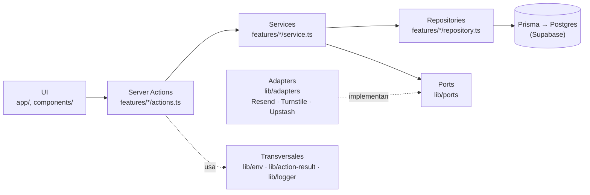
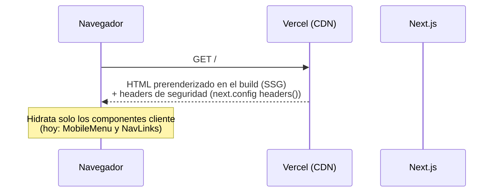

# Arquitectura

Resumen de la arquitectura vigente. La fuente de verdad es [`SPEC.md`](SPEC.md) §6; este documento explica cómo está armado **hoy** el código y hacia dónde va. Se actualiza en cada tarea que cambie estructura o flujos.

Última actualización: F2-08 (22/11/2026). El sitio público de la Fase 2 está implementado; el formulario, la base y los mails llegan en F3.

## Principios

1. **Server-first.** Las páginas públicas se renderizan de forma estática (SSG). Solo el formulario y el panel admin son dinámicos. El JavaScript de cliente se limita a lo interactivo (hoy: el menú mobile y la marca de página actual).
2. **Capas con dependencias hacia adentro.** UI → Server Actions → Services → Repositories / Ports. Los services no conocen Next, Prisma ni SDKs ([ADR 0001](adr/0001-arquitectura-en-capas-por-feature.md)).
3. **Ports & adapters** para servicios externos (mail, captcha, rate limit, reloj): se cambian o se simulan en tests sin tocar la lógica.
4. **Un tenant por instalación:** cada estudio cliente tiene su deploy, su base y su configuración ([ADR 0003](adr/0003-un-tenant-por-instalacion.md)).
5. **Configuración y contenido separados del código:** los datos del estudio viven en `src/config` y `src/content`.
6. **Seguro por defecto:** validación con Zod en el servidor, secretos solo del lado del servidor, headers de seguridad en todas las rutas y logs sin datos personales.

## Capas

| Capa           | Responsabilidad                                                                                   | Regla clave                                      |
| -------------- | ------------------------------------------------------------------------------------------------- | ------------------------------------------------ |
| UI             | Páginas, layouts y componentes. Server Components por defecto.                                    | `"use client"` solo si hay interactividad.       |
| Server Actions | Parsean el input con Zod, chequean auth, llaman al service y devuelven `ActionResult<T>`.         | Sin lógica de negocio.                           |
| Services       | Reglas de negocio puras. Reciben repos y ports por parámetro.                                     | Nunca importan Prisma ni SDKs.                   |
| Repositories   | Acceso a datos.                                                                                   | Único lugar que toca Prisma.                     |
| Ports/Adapters | Interfaces de servicios externos y sus implementaciones.                                          | Los SDKs solo se importan en los adapters.       |
| Auth (F4)      | `requireStaff()` en `features/auth/dal.ts`, en **cada** página y action del admin.                | El `proxy` es solo una primera barrera.          |

## Estructura: qué existe hoy y qué viene

| Ruta                          | Estado      | Contenido                                                                                      |
| ----------------------------- | ----------- | ---------------------------------------------------------------------------------------------- |
| `src/app/layout.tsx`          | ✅ F1-07    | Layout raíz: `lang="es-AR"`, fuentes (`next/font`), metadata base.                             |
| `src/app/globals.css`         | ✅ F1-07    | Tokens de diseño (SPEC §11.1).                                                                 |
| `src/app/(public)/`           | ✅ F2-07    | Layout público y las páginas de FR-01. El formulario de Contacto llega en F3.                  |
| `src/app/admin/`              | ⏳ F4       | Login, listado y detalle de consultas.                                                         |
| `src/app/sitemap.ts`, `robots.ts`, `opengraph-image.tsx` | ✅ F2-06 | SEO técnico, generado en el build.                                  |
| `src/app/not-found.tsx`, `error.tsx` y los de `(public)/` | ✅ F2-07 | Páginas de error amigables (FR-16). |
| `src/components/ui/`          | ✅ F1-07    | shadcn/ui (generados).                                                                         |
| `src/components/layout/`      | ✅ F1-07    | Header, MobileMenu, NavLinks, SafetyNotice, Footer, SkipLink, DemoBanner, WhatsAppButton, CtaLink, PublicShell, NotFoundView, ErrorView.                     |
| `src/components/marketing/`   | ✅ F2-07    | Bloques del sitio público; los datos del estudio llegan por props (`UrgentNote` lee su texto fijo de `src/content`). |
| `src/config/site.config.ts`   | ✅ F1-07    | Datos del estudio (ficticios en la demo).                                                      |
| `src/content/`                | ✅ F2-07    | Áreas, preguntas, textos de cada página y de error, ayuda urgente y privacidad como datos.     |
| `src/lib/seo/`                | ✅ F2-06    | Metadata, rutas del sitemap, datos estructurados y `<JsonLd>` seguro.                          |
| `src/lib/format-date.ts`      | ✅ F2-04    | Fechas largas en es-AR.                                                                        |
| `src/features/inquiries/`     | ⏳ F3–F4    | Consultas: schema, service, repository, actions, mails y componentes.                          |
| `src/features/auth/`          | ⏳ F4       | DAL (`requireStaff`), actions de login y repositorio de staff.                                 |
| `src/lib/env*.ts`             | ✅ F1-04    | Variables de entorno validadas ([ADR 0006](adr/0006-validacion-de-variables-de-entorno.md)).   |
| `src/lib/action-result.ts`    | ✅ F1-04    | Contrato `ActionResult<T>` de las Server Actions (SPEC §6.5).                                  |
| `src/lib/logger.ts`           | ✅ F1-04    | Logger JSON sin datos personales.                                                              |
| `src/lib/security/headers.ts` | ✅ F1-06    | Headers de seguridad y CSP ([ADR 0007](adr/0007-csp-report-only-sin-nonces.md)).               |
| `src/lib/whatsapp.ts`, `utils.ts` | ✅ F1-07 | Link de WhatsApp (FR-13) y `cn()`.                                                           |
| `src/lib/ports/`, `adapters/` | ⏳ F3       | Interfaces y adapters de Resend, Turnstile y Upstash.                                          |
| `src/lib/db.ts`, `supabase/`  | ⏳ F3–F4    | Cliente Prisma y clientes de Supabase.                                                         |
| `proxy.ts`                    | ⏳ F4       | Refresh de sesión y redirect de `/admin`.                                                      |
| `prisma/`                     | ⏳ F3       | Schema y migraciones (SPEC §7).                                                                |

## Flujos vigentes

### Arranque y validación de entorno

Al cargar `next.config.ts` (en `next dev`, `next build` y `next start`) se validan todas las variables con los schemas de `src/lib/env.schema.ts`. Si falta una obligatoria o tiene formato inválido, el proceso termina con un mensaje que nombra la variable, nunca su valor. En runtime, el código lee las variables desde `env.ts` (servidor, con `server-only`) o `env.public.ts` (cliente). Ver [ADR 0006](adr/0006-validacion-de-variables-de-entorno.md).

### Request a una página pública

- Los headers (HSTS, `nosniff`, `Referrer-Policy`, `Permissions-Policy`, `X-Frame-Options`, CSP report-only) se aplican a **todas** las rutas desde `next.config.ts`.
- El layout público arma la página con datos de `site.config.ts`: banner de demo (salvo `NEXT_PUBLIC_DEMO_MODE=false`, [ADR 0011](adr/0011-modo-demo-por-defecto.md)), header, `<main id="contenido">`, footer con la ayuda ante peligro, botón de WhatsApp y JSON-LD `LegalService`.
- **Header y WhatsApp:** debajo del breakpoint `gutter` (86.25rem = 1380 px) el header es fijo y lleva WhatsApp; desde ahí WhatsApp flota en el margen. Debajo de `lg` el nombre del estudio puede partir en dos líneas (letra del navegador agrandada). El espacio para el header fijo se da con `scroll-margin-top` en el contenido, **no** con `scroll-padding` en `html` (haría saltar la página al enfocar el header).
- **Página actual:** `NavLinks` lee `usePathname` en un subcomponente que no dibuja nada, dentro de `Suspense`. No envuelvas la lista en ese `Suspense`: React reemplazaría los links al cargar y se perdería el foco.
- Las áreas se generan con `generateStaticParams`; un slug desconocido espera el render completo y responde 404 ([ADR 0009](adr/0009-rutas-dinamicas-estaticas-con-cache-components.md)).
- **404 y errores (FR-16):** `notFound()` dentro de una ruta pública usa `(public)/not-found.tsx`, dentro del layout. Una URL sin ruta usa `app/not-found.tsx`, que trae su propio `PublicShell` porque queda fuera de ese layout. Los errores usan `error.tsx` con `retry()` y nunca muestran detalles internos.
- Cada página arma su metadata con `buildPageMetadata`. En modo demo, todas llevan `noindex, nofollow` ([ADR 0010](adr/0010-seo-json-ld-seguro-y-noindex-en-demo.md)).

## Flujos planificados

- **Enviar consulta (F3):** honeypot → rate limit → validación → Turnstile → `createInquiry` (consulta + evento `CREATED` en una transacción) → respuesta con número de referencia → mails con `after()` (aviso con los datos de contacto seguro; acuse neutro, solo si `emailIsPrivate`: SPEC US-03 y US-05). Diagrama en SPEC §6.3; decisiones en [ADR 0004](adr/0004-anti-abuso-honeypot-rate-limit-turnstile.md) y [ADR 0005](adr/0005-mails-despues-de-responder.md).
- **Panel admin (F4):** `proxy` refresca la sesión y redirige `/admin/*` sin sesión; el layout protegido y cada action llaman a `requireStaff()`, que verifica el usuario contra Supabase Auth y busca un `StaffMember` activo. Detalle en SPEC §6.4; datos en [ADR 0002](adr/0002-supabase-con-prisma-y-rls.md).

## Decisiones vigentes

| ADR                                                              | Decisión                                                       | Estado                     |
| ---------------------------------------------------------------- | -------------------------------------------------------------- | -------------------------- |
| [0001](adr/0001-arquitectura-en-capas-por-feature.md)            | Capas con ports & adapters, organizadas por feature            | Aceptada                   |
| [0002](adr/0002-supabase-con-prisma-y-rls.md)                    | Supabase + Prisma; RLS sin políticas; sin service role key     | Aceptada (se implementa en F3) |
| [0003](adr/0003-un-tenant-por-instalacion.md)                    | Un tenant por instalación                                      | Aceptada                   |
| [0004](adr/0004-anti-abuso-honeypot-rate-limit-turnstile.md)     | Anti-abuso: honeypot + rate limit + Turnstile                  | Aceptada (se implementa en F3) |
| [0005](adr/0005-mails-despues-de-responder.md)                   | Mails con `after()`, sin el mensaje completo                   | Aceptada (se implementa en F3) |
| [0006](adr/0006-validacion-de-variables-de-entorno.md)           | Validación de env en `next.config.ts`, pública/privada         | Aceptada                   |
| [0007](adr/0007-csp-report-only-sin-nonces.md)                   | CSP report-only sin nonces para mantener SSG                   | Aceptada (se revisa en F5-01) |
| [0008](adr/0008-politica-de-npm-audit-en-ci.md)                  | `npm audit` bloqueante solo para producción                    | Aceptada                   |
| [0009](adr/0009-rutas-dinamicas-estaticas-con-cache-components.md) | Rutas dinámicas estáticas con 404 real                       | Aceptada                   |
| [0010](adr/0010-seo-json-ld-seguro-y-noindex-en-demo.md)         | JSON-LD seguro y noindex en modo demo                          | Aceptada                   |
| [0011](adr/0011-modo-demo-por-defecto.md) | Modo demo encendido por defecto | Aceptada |

Otras decisiones de diseño (paleta, tipografías, tema único claro) están en SPEC §11.1 y su registro de cambios (§17).
