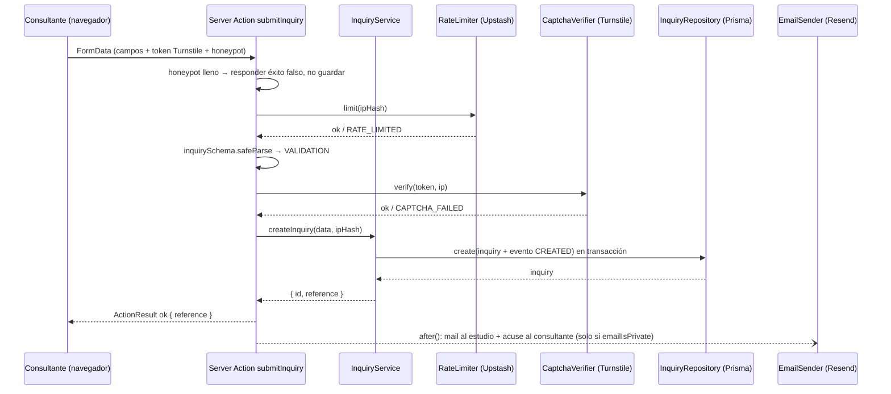

# SPEC — Demo 1: Sitio + sistema de consultas para estudio de familia y sucesiones

| | |
|---|---|
| Versión | 1.19 (24/11/2026) |
| Dueño del spec | [tu nombre] |
| Estado | Aprobado para empezar Fase 1 |
| Referenciado desde | `CLAUDE.md` |

---

## 0. Cómo se usa este documento

Este proyecto sigue **spec-driven development**:

1. **Spec** (este documento) define *qué* y *por qué*, y las restricciones de *cómo*.
2. **Plan**: para cada tarea de `docs/GUIA_DE_AVANCE.md`, la IA propone un plan que referencia requisitos de este spec por ID (`FR-xx`, `NFR-xx`, `US-xx`).
3. **Aprobación** del plan por el dueño.
4. **Implementación + tests.**
5. **Verificación** por el dueño (tests automáticos + manuales) y cierre de la tarea.

Si durante el trabajo aparece algo que el spec no cubre o que contradice, **se actualiza el spec primero** (sección 17) y después el código.

---

## 1. Contexto y objetivo

Los estudios jurídicos chicos de la zona (1 a 5 profesionales) suelen no tener web, o tener solo Instagram o una web gratuita. Pierden consultas de gente que los encuentra en Google y no tiene cómo contactarlos de forma ordenada, sobre todo fuera de horario.

**Objetivo de la demo:** mostrarle a un estudio de familia y sucesiones cómo se vería su web profesional con un sistema de consultas que:

- genera confianza para que la persona se anime a escribir;
- le hace las preguntas justas para que la consulta llegue ordenada (tipo de caso, urgencia, canal preferido);
- le avisa al estudio por mail y le deja gestionar las consultas desde un panel simple.

**Objetivo técnico:** que sea una base **segura, mantenible, escalable y eficiente**, reutilizable para clientes reales cambiando configuración y contenido.

**Indicadores de éxito de la demo:**
- Lighthouse mobile ≥ 90 en Performance, Accessibility, Best Practices y SEO en todas las páginas públicas. SEO se mide sobre un build con el modo demo apagado, porque la demo lleva `noindex` a propósito (FR-15, ADR-0010).
- Enviar una consulta desde el celular lleva menos de 2 minutos.
- 0 errores de lint o tipos y tests en verde en `main`.

---

## 2. Alcance

### Incluido (v1)
- Sitio público de varias páginas: Inicio, Áreas de práctica (índice + una página por área), Nosotros, Preguntas frecuentes, Contacto, Política de privacidad.
- Formulario "Contanos tu caso" en dos pasos, con validación, anti-spam (Turnstile + rate limit + honeypot) y consentimiento de datos.
- Guardado de consultas en Postgres (Supabase) vía Prisma.
- Mail al estudio (nueva consulta) y acuse de recibo a quien consulta, si su email es privado (Resend).
- Botón de WhatsApp siempre visible y links de contacto.
- Panel admin con login (Supabase Auth): listado con filtros y paginación, detalle, cambio de estado, notas internas e historial de cambios.
- SEO técnico: metadata, Open Graph, sitemap, robots y datos estructurados (JSON-LD).
- Modo demo: banner visible "Sitio de demostración — estudio ficticio".
- Tests automáticos (unit, integración y e2e), CI y guía de tests manuales.

### Excluido (v1). Candidatos para la demo 2 o para clientes reales
- Turnos online, pagos (Mercado Pago), funciones con LLM, blog o CMS, múltiples idiomas, múltiples estudios en una misma instalación, roles de staff distintos de ADMIN, notificaciones por WhatsApp automáticas.

---

## 3. Usuarios

| Actor | Descripción | Necesita |
|---|---|---|
| **Consultante** | Persona atravesando un divorcio, una sucesión o un conflicto familiar. Suele estar angustiada, entra desde el celular y no sabe de derecho. | Entender si el estudio puede ayudarla, sentirse segura y escribir sin fricción. |
| **Profesional / staff del estudio** | Abogado o abogada titular, o secretaria. | Enterarse rápido de consultas nuevas, verlas ordenadas por urgencia y área, y registrar el seguimiento. |
| **Dueño técnico** | Vos (y la SAS). | Poder mantener, adaptar y revender la base sin reescribirla. |

---

## 4. Historias de usuario y criterios de aceptación

**US-01 — Entender qué hace el estudio.** Como consultante, quiero ver en el inicio qué casos atiende el estudio y cómo trabaja, para decidir si lo contacto.
- CA1: El inicio muestra, sin hacer scroll en mobile (desde 320×568, con el banner de demo), quién es el estudio, en qué se especializa y un botón "Contanos tu caso".
- CA2: Hay una sección de áreas con link a cada página de área.
- CA3: Hay una sección "Cómo trabajamos" de 3 pasos y señales de confianza: matrícula, dirección física, horarios y confidencialidad.

**US-02 — Informarme sobre mi tema.** Como consultante, quiero leer sobre mi situación (ej. sucesión) en lenguaje simple.
- CA1: Cada área tiene su página con: qué es, cuándo conviene consultar, qué documentación suele hacer falta, preguntas frecuentes del área y un llamado a la acción.
- CA2: Cada página tiene metadata y datos estructurados propios.

**US-03 — Enviar una consulta.** Como consultante, quiero contar mi caso y dejar mis datos para que me contacten.
- CA1: El formulario tiene 2 pasos: (1) área, urgencia y mensaje; (2) nombre, email, teléfono opcional, canal preferido y consentimiento.
- CA2: Los errores se muestran junto a cada campo, en español claro, y se anuncian a lectores de pantalla.
- CA3: Al enviar, se ve una confirmación con un número de referencia y qué va a pasar después ("Te vamos a contactar dentro de las próximas 24 a 48 horas hábiles"). Si no hay un medio seguro (CA7), no promete contacto: le pide guardar la referencia y comunicarse con el estudio cuando pueda hacerlo con seguridad.
- CA4: Si el envío falla, los datos escritos no se pierden.
- CA5: Solo si el email es privado (CA7), llega un acuse de recibo con remitente, asunto, texto y firma neutros: sin el área, sin la especialidad del estudio (ej. "Familia y Sucesiones") ni nada que revele el motivo de la consulta (§11.5).
- CA6: Si elige teléfono o WhatsApp, se le pregunta "¿Es seguro que te contactemos por ese medio?". Si responde que no, se la contacta por email solo si es privado (CA7). La respuesta se muestra destacada en el detalle del panel y en el aviso al estudio.
- CA7: El formulario pregunta siempre "¿Este email es privado (solo lo leés vos)?" (`emailIsPrivate`), sin valor por defecto, porque una casilla compartida puede delatar la consulta. Si responde que no, no se le manda ningún email y la referencia se ve solo en pantalla. El estudio inicia el contacto solo por un **medio seguro**: teléfono o WhatsApp con `safeToContact = true`, o email con `emailIsPrivate = true`. Si no hay ninguno (incluye elegir email cuando no es privado), no lo inicia, y el panel y el aviso al estudio destacan "No iniciar contacto".

**US-04 — Contactar por WhatsApp.** Como consultante, quiero escribir por WhatsApp si lo prefiero.
- CA1: Hay un botón de WhatsApp siempre visible en todas las páginas públicas, con un mensaje precargado genérico (sin datos personales). Nunca tapa contenido: va en el header fijo hasta 1379 px y flota desde 1380 px, donde hay margen lateral.

**US-05 — Enterarme de consultas nuevas.** Como staff, quiero recibir un mail por cada consulta nueva.
- CA1: El mail incluye área, urgencia, canal preferido, si es seguro contactar por ese canal (destacado, US-03 CA6), si el email es privado y, si corresponde, "No iniciar contacto" (destacado, US-03 CA7), número de referencia y un link al detalle en el panel. Incluye el nombre de quien consulta, pero **no** el texto completo del mensaje (minimización de datos; se lee en el panel).

**US-06 — Gestionar consultas.** Como staff, quiero ver, filtrar y actualizar las consultas.
- CA1: Login con email y contraseña. No existe registro público.
- CA2: Listado paginado (20 por página), ordenado por fecha (las más nuevas primero), con filtros por estado, área y urgencia, y búsqueda por nombre o email.
- CA3: Detalle con todos los datos, cambio de estado, notas internas e historial de cambios (quién, qué y cuándo).
- CA4: Un usuario autenticado que no está registrado como staff activo no puede ver nada del panel.

**US-07 — Privacidad.** Como consultante, quiero saber qué se hace con mis datos.
- CA1: Página de política de privacidad conforme a la Ley 25.326, linkeada desde el formulario y el footer.
- CA2: El consentimiento es una casilla obligatoria, sin marcar por defecto. Se guarda la fecha y la versión de la política aceptada.

---

## 5. Requisitos funcionales

| ID | Requisito |
|---|---|
| FR-01 | Rutas públicas: `/`, `/areas`, `/areas/[slug]`, `/nosotros`, `/preguntas-frecuentes`, `/contacto`, `/privacidad`. |
| FR-02 | Las áreas v1 son: Sucesiones, Divorcios, Alimentos, Cuidado personal y régimen de comunicación, Convenios y acuerdos familiares. Se definen en `src/content/practice-areas.ts`. |
| FR-03 | Todo dato del estudio sale de `src/config/site.config.ts` (nombre, profesionales y matrículas, dirección, horarios, teléfono, WhatsApp, email público, redes, coordenadas, jurisdicción donde litiga y monograma del ícono). |
| FR-04 | El formulario de consulta usa una Server Action `submitInquiry` con mejora progresiva (`useActionState`). |
| FR-05 | Validación compartida cliente/servidor con un único schema Zod (`inquirySchema`). |
| FR-06 | Anti-abuso en el envío, en este orden: honeypot → rate limit → validación → Turnstile. |
| FR-07 | Una consulta guardada crea un evento `CREATED` en su historial (en la misma transacción). |
| FR-08 | Los mails se envían **después** de responder al usuario (`after()` de Next). Si fallan no se pierde la consulta: se loguea el error con el ID. |
| FR-09 | Número de referencia legible, derivado del ID (ej. `C-7F3A9B21`): los primeros 8 caracteres del UUID en mayúscula. |
| FR-10 | Panel en `/admin` (listado), `/admin/consultas/[id]` (detalle) y `/admin/login`. |
| FR-11 | Estados: `NEW` (Nueva), `IN_REVIEW` (En revisión), `CONTACTED` (Contactada), `CLOSED` (Cerrada), `DISCARDED` (Descartada). Se permite cualquier transición entre estados distintos. |
| FR-12 | Cada cambio de estado o de notas crea un `InquiryEvent` con el actor. |
| FR-13 | Botón de WhatsApp con link `https://wa.me/<número>?text=<mensaje genérico codificado>`. |
| FR-14 | `sitemap.xml`, `robots.txt` (el panel y `/admin/*` excluidos e indicados `noindex`), metadata por página y JSON-LD (`LegalService` en el layout y `FAQPage` en preguntas frecuentes). |
| FR-15 | Banner de modo demo controlado por `NEXT_PUBLIC_DEMO_MODE`: encendido salvo que valga `false` explícito (ADR-0011). En modo demo el sitio no se indexa (`noindex, nofollow`), sin bloquear el rastreo. En celulares el banner muestra solo "Sitio de demostración — estudio ficticio"; la aclaración sobre los datos aparece desde tablet. |
| FR-16 | Página 404 y página de error amigables, con link al inicio y a contacto. |

---

## 6. Arquitectura

### 6.1 Principios
- **Server-first:** las páginas públicas se renderizan estáticamente (SSG). Solo el formulario y el panel son dinámicos.
- **Capas con dependencias hacia adentro** (UI → actions → services → repositories/ports). Los services no conocen Next, Prisma ni SDKs.
- **Ports & adapters** para servicios externos (mail, captcha, rate limit, reloj): se cambian o se simulan en tests sin tocar la lógica.
- **Un tenant por instalación** (ADR-0003): cada estudio cliente tiene su propio deploy, su base y su configuración. Más simple y más seguro que multi-tenant para este negocio.
- **Configuración y contenido separados del código.**

### 6.2 Estructura de carpetas

```
src/
  app/
    (public)/                    # layout público: header, footer, WhatsApp, banner demo
      page.tsx                   # inicio
      areas/page.tsx
      areas/[slug]/page.tsx      # generateStaticParams desde content
      nosotros/page.tsx
      preguntas-frecuentes/page.tsx
      contacto/page.tsx
      privacidad/page.tsx
    admin/
      login/page.tsx
      (protected)/layout.tsx     # llama a requireStaff()
      (protected)/page.tsx       # listado
      (protected)/consultas/[id]/page.tsx
    sitemap.ts
    robots.ts
    opengraph-image.tsx
    icon.tsx, apple-icon.tsx     # ícono con el monograma del estudio; /favicon.ico se reescribe a /icon
    not-found.tsx                # 404 de URLs sin ruta (con PublicShell)
    error.tsx                    # último recurso; (public)/ tiene su not-found.tsx y su error.tsx
    globals.css                  # tokens de diseño (Tailwind)
    layout.tsx
  components/
    ui/                          # shadcn (generado)
    layout/                      # Header, MobileMenu, NavLinks, SafetyNotice, Footer, SkipLink, DemoBanner, WhatsAppButton, CtaLink, PublicShell, NotFoundView, ErrorView (archivos en kebab-case)
    marketing/                   # Hero, PracticeAreaCard, ProcessSteps, TrustBar, FaqList, UrgentNote, CTA
  features/
    inquiries/
      schema.ts                  # Zod: inquirySchema, updateStatusSchema, updateNotesSchema, listFiltersSchema
      types.ts                   # enums y tipos de dominio (sin depender de Prisma)
      contact-safety.ts          # planContact: medio seguro, "No iniciar contacto" y acuse (US-03 CA5–CA7)
      service.ts                 # createInquiry, listInquiries, getInquiry, changeStatus, updateNotes; declara InquiryRepository
      repository.ts              # Prisma (implementa InquiryRepository)
      reference.ts               # toReference: C-XXXXXXXX (FR-09)
      errors.ts                  # InquiryStoreError, InvalidInquiryInputError
      actions.ts                 # submitInquiry, updateInquiryStatus, updateInquiryNotes
      emails/                    # React Email: NewInquiryEmail, InquiryReceiptEmail
      components/                # InquiryForm (client), InquiryTable, StatusBadge, ...
      __tests__/
    auth/
      dal.ts                     # requireStaff(), getCurrentStaff()
      actions.ts                 # signIn, signOut
      repository.ts              # StaffMember
      __tests__/
  lib/
    env.ts                       # server-only: exporta env (públicas + privadas validadas); entrada para código de servidor
    env.public.ts                # solo NEXT_PUBLIC_*, seguro para componentes cliente
    env.schema.ts                # schemas Zod puros; next.config.ts lo usa para fallar dev/build/start
    db.ts                        # Prisma client singleton (getDb(), lazy, pooler)
    db-tls.ts                    # TLS verificado contra la CA de Supabase (app y CLI de Prisma)
    supabase/server.ts           # cliente SSR (cookies)
    supabase/client.ts           # cliente browser (solo si hace falta)
    ports/                       # EmailSender, CaptchaVerifier, RateLimiter, Clock (sin excepciones, ADR-0013)
    ports/fakes/                 # fakes en memoria, solo para tests
    adapters/                    # ResendEmailSender, TurnstileVerifier, UpstashRateLimiter, systemClock
    adapters/index.ts            # raíz de composición: getEmailSender(), getCaptchaVerifier(), getRateLimiter(), getClock()
    action-result.ts             # tipo ActionResult + helpers
    utils.ts                     # cn() (lo genera shadcn)
    whatsapp.ts                  # buildWhatsAppUrl (FR-13)
    format-date.ts               # formatLongDate (fechas en es-AR, sin depender de la zona horaria)
    logger.ts                    # logger estructurado sin PII
    security/ip.ts               # obtener IP de headers y hashearla (HMAC-SHA256 con IP_HASH_SALT)
    security/headers.ts          # headers de seguridad y CSP (NFR-SEC-04/05); lo usa next.config.ts
    seo/json-ld.tsx              # serialización segura de JSON-LD
    seo/structured-data.ts       # builders de schema.org
    seo/page-metadata.ts         # metadata por página (canonical, OG) y robots
    seo/routes.ts                # rutas públicas del sitemap
    seo/og-image.ts              # datos de la imagen OG
    seo/brand-colors.ts          # tokens para la imagen OG (test contra globals.css)
    seo/app-icon.tsx             # dibuja los íconos de la pestaña y de inicio
  config/
    site.config.ts
    rate-limits.ts               # límites anti-abuso (§8.2)
  content/
    home.ts                      # textos del inicio (hero, pasos, títulos de sección)
    area-pages.ts                # textos de /areas y rótulos de las páginas de área
    about.ts                     # textos de /nosotros (enfoque y valores)
    faq-page.ts                  # textos de /preguntas-frecuentes
    contact-page.ts              # textos de /contacto
    urgent-help.ts               # ayuda ante peligro y plazos (§11.5)
    error-pages.ts               # textos de la 404 y de la página de error
    practice-areas.ts
    faqs.ts
    legal/privacy.ts             # texto de la política + versión
  generated/prisma/              # cliente de Prisma generado (prisma generate); fuera de git
proxy.ts                         # (o middleware.ts según la versión de Next) refresh de sesión y redirect de /admin
prisma.config.ts                 # config de la CLI de Prisma 7: carga .env* y usa DIRECT_URL (ADR-0012)
prisma/
  schema.prisma
  migrations/
  __tests__/                     # rls.test.ts: toda tabla tiene RLS en una migración
  certs/supabase-ca.crt          # CA pública de Supabase para verificar TLS
tests/e2e/                       # Playwright
docs/
  SPEC.md · GUIA_DE_AVANCE.md · ARCHITECTURE.md · TESTING.md · adr/
```

### 6.3 Flujo: enviar consulta



### 6.4 Flujo: admin
1. `proxy` refresca la sesión de Supabase y redirige `/admin/*` a `/admin/login` si no hay sesión (primera barrera, optimista).
2. `app/admin/(protected)/layout.tsx` y **cada** action admin llaman a `requireStaff()`:
   - obtiene el usuario verificado con el servidor de Supabase Auth (no confiar en la sesión de cookies sin verificar);
   - busca `StaffMember` activo por `authUserId`;
   - si no existe: `redirect('/admin/login?error=forbidden')` (páginas) o `FORBIDDEN` (actions).
3. Las lecturas del panel se hacen en Server Components vía service → repository. Las mutaciones van por Server Actions.

### 6.5 Contrato de las Server Actions

```ts
type ActionErrorCode =
  | 'VALIDATION' | 'RATE_LIMITED' | 'CAPTCHA_FAILED'
  | 'UNAUTHORIZED' | 'FORBIDDEN' | 'NOT_FOUND' | 'INTERNAL';

type ActionResult<T> =
  | { ok: true; data: T }
  | { ok: false; error: { code: ActionErrorCode; message: string; fieldErrors?: Record<string, string[]> } };
```

| Action | Input | Output OK | Errores posibles |
|---|---|---|---|
| `submitInquiry(prev, formData)` | campos de §8.1 + `cf-turnstile-response` + `website` (honeypot) | `{ reference: string }` | VALIDATION, RATE_LIMITED, CAPTCHA_FAILED, INTERNAL |
| `updateInquiryStatus({ id, status })` | UUID + enum | `{ status }` | UNAUTHORIZED, FORBIDDEN, VALIDATION, NOT_FOUND, INTERNAL |
| `updateInquiryNotes({ id, notes })` | UUID + string ≤ 5000 | `{ updatedAt }` | ídem |
| `signIn(prev, formData)` | email + password | redirect `/admin` | VALIDATION, UNAUTHORIZED (mensaje genérico), RATE_LIMITED |
| `signOut()` | — | redirect `/admin/login` | — |

Los mensajes de error al usuario son genéricos y en español. El login nunca revela si el email existe.

---

## 7. Modelo de datos

Borrador del `schema.prisma`. La sintaxis exacta del generator y del datasource depende de la versión de Prisma instalada: seguir su documentación. Con Prisma 7 las URLs no van en el `datasource`: `DIRECT_URL` va en `prisma.config.ts` (migraciones) y `DATABASE_URL` en `lib/db.ts` (runtime, con `@prisma/adapter-pg`) (ADR-0012).

```prisma
enum PracticeArea { SUCCESSION DIVORCE CHILD_SUPPORT PARENTING AGREEMENTS OTHER }
enum Urgency { LOW NORMAL HIGH }
enum ContactChannel { WHATSAPP PHONE EMAIL }
enum InquiryStatus { NEW IN_REVIEW CONTACTED CLOSED DISCARDED }
enum InquiryEventType { CREATED STATUS_CHANGED NOTES_UPDATED }
enum StaffRole { ADMIN }

model Inquiry {
  id                   String         @id @default(uuid()) @db.Uuid
  createdAt            DateTime       @default(now()) @map("created_at")
  updatedAt            DateTime       @updatedAt @map("updated_at")
  fullName             String         @map("full_name") @db.VarChar(120)
  email                String         @db.VarChar(254)
  phone                String?        @db.VarChar(30)
  area                 PracticeArea
  urgency              Urgency
  message              String         @db.VarChar(2000)
  preferredChannel     ContactChannel @map("preferred_channel")
  safeToContact        Boolean?       @map("safe_to_contact")   // US-03 CA6; null si el canal es EMAIL
  emailIsPrivate       Boolean        @map("email_is_private")  // US-03 CA7
  consentAt            DateTime       @map("consent_at")
  privacyPolicyVersion String         @map("privacy_policy_version") @db.VarChar(20)
  status               InquiryStatus  @default(NEW)
  internalNotes        String?        @map("internal_notes") @db.VarChar(5000)
  ipHash               String?        @map("ip_hash") @db.VarChar(64)
  source               String?        @db.VarChar(100)   // utm_source u origen
  events               InquiryEvent[]

  @@index([status, createdAt])
  @@index([area, createdAt])
  @@index([createdAt])
  @@map("inquiries")
}

model InquiryEvent {
  id         String           @id @default(uuid()) @db.Uuid
  inquiryId  String           @map("inquiry_id") @db.Uuid
  inquiry    Inquiry          @relation(fields: [inquiryId], references: [id], onDelete: Cascade)
  type       InquiryEventType
  fromStatus InquiryStatus?   @map("from_status")
  toStatus   InquiryStatus?   @map("to_status")
  actorId    String?          @map("actor_id") @db.Uuid   // StaffMember.id; null en CREATED
  createdAt  DateTime         @default(now()) @map("created_at")

  @@index([inquiryId, createdAt])
  @@map("inquiry_events")
}

model StaffMember {
  id         String    @id @default(uuid()) @db.Uuid
  authUserId String    @unique @map("auth_user_id") @db.Uuid  // auth.users.id de Supabase
  email      String    @unique @db.VarChar(254)
  fullName   String    @map("full_name") @db.VarChar(120)
  role       StaffRole @default(ADMIN)
  active     Boolean   @default(true)
  createdAt  DateTime  @default(now()) @map("created_at")
  @@map("staff_members")
}
```

**Reglas:**
- Migraciones solo con `prisma migrate` versionadas en git. Nunca `db push` contra producción.
- **RLS habilitado en todas las tablas del esquema `public`** (`inquiries`, `inquiry_events`, `staff_members` y `_prisma_migrations`, que crea Prisma), **sin políticas** para `anon` ni `authenticated`: la Data API de Supabase no puede leerlas. Prisma accede con la conexión de Postgres. Se hace en una migración SQL, y un test verifica que toda tabla nueva lo tenga.
- Alta de staff: script `npm run staff:add -- --email x --name y` que vincula un usuario creado en Supabase Auth (el registro público está deshabilitado en Supabase).
- Retención: las consultas en `CLOSED` o `DISCARDED` con más de 24 meses se eliminan (script manual en v1; cron en v2). Documentado en la política de privacidad.

---

## 8. Validación

### 8.1 `inquirySchema`

| Campo | Regla | Mensaje |
|---|---|---|
| `area` | enum PracticeArea | "Elegí el tipo de consulta" |
| `urgency` | enum Urgency | "Indicá la urgencia" |
| `message` | trim, 20 a 2000 caracteres | "Contanos un poco más (mínimo 20 caracteres)" / "Máximo 2000 caracteres" |
| `fullName` | trim, 2 a 120 caracteres, letras, espacios, `'` y `-`; el apóstrofo tipográfico `’` (iOS) se acepta y se guarda como `'` | "Ingresá tu nombre" |
| `email` | trim, minúsculas, email válido, ≤ 254 | "Ingresá un email válido" |
| `phone` | opcional; si viene, solo `+`, dígitos, espacios y `-`, entre 8 y 20 dígitos | "Ingresá un teléfono válido" |
| `preferredChannel` | enum; si es `PHONE` o `WHATSAPP`, `phone` es obligatorio | "Elegí cómo preferís que te contactemos" / "Para contactarte por ese medio necesitamos tu teléfono" |
| `safeToContact` | booleano; obligatorio si `preferredChannel` es `PHONE` o `WHATSAPP`, sin valor por defecto | "Decinos si es seguro contactarte por ese medio" |
| `emailIsPrivate` | booleano; obligatorio siempre, sin valor por defecto | "Decinos si este email es privado" |
| `consent` | debe ser `true` | "Necesitamos tu consentimiento para responderte" |
| `website` | honeypot: debe venir vacío (no se muestra error). Lo revisa la action antes que el schema (FR-06) | — |

Todos los errores se informan a la vez, incluidos los que dependen del canal (US-03 CA2). La regla de medio seguro (US-03 CA6 y CA7) vive en `contact-safety.ts` y es la única fuente para la confirmación, los mails y el panel.

Etiquetas de interfaz:
- **Urgencia:** LOW = "Sin apuro", NORMAL = "En las próximas semanas", HIGH = "Tengo un plazo o una audiencia cercana".
- **Áreas:** Sucesiones, Divorcio, Alimentos, Cuidado personal y régimen de comunicación, Convenios y acuerdos, Otro tema de familia.

### 8.2 Límites anti-abuso
- Rate limit de consultas: **5 por IP cada 10 minutos** y **3 por email cada hora**.
- Rate limit de login: **5 intentos por IP cada 15 minutos**.
- Turnstile verificado del lado del servidor con `TURNSTILE_SECRET_KEY`, IP y hostname esperado.
- En dev, test, CI y Preview de Vercel se usan las claves de prueba oficiales de Turnstile; las reales, solo en Production (ADR-0013).
- Si un servicio no responde (ADR-0013): con el rate limit caído, se deja pasar y se registra en el log; con Turnstile caído, se rechaza (`CAPTCHA_FAILED`).
- Las claves del rate limit son hashes: Upstash nunca recibe un email ni una IP.

---

## 9. Integraciones y variables de entorno

| Variable | Pública | Uso |
|---|---|---|
| `NEXT_PUBLIC_SITE_URL` | sí | URLs absolutas, sitemap, OG |
| `NEXT_PUBLIC_DEMO_MODE` | sí | banner demo y noindex; si falta vale `true` (ADR-0011) |
| `NEXT_PUBLIC_SUPABASE_URL` | sí | Auth |
| `NEXT_PUBLIC_SUPABASE_PUBLISHABLE_KEY` | sí | Auth (o la anon key, según el tipo de claves del proyecto) |
| `DATABASE_URL` | no | Prisma en runtime (pooler de Supabase) |
| `DIRECT_URL` | no | Prisma migraciones (conexión directa o sesión) |
| `RESEND_API_KEY` | no | mails |
| `EMAIL_FROM` | no | remitente (dominio verificado en Resend); nombre y dirección sin la especialidad del estudio (US-03 CA5) |
| `FIRM_NOTIFICATION_EMAIL` | no | destinatario de consultas nuevas |
| `NEXT_PUBLIC_TURNSTILE_SITE_KEY` | sí | widget |
| `TURNSTILE_SECRET_KEY` | no | verificación |
| `UPSTASH_REDIS_REST_URL` / `UPSTASH_REDIS_REST_TOKEN` | no | rate limit |
| `IP_HASH_SALT` | no | HMAC de IPs (32+ caracteres aleatorios) |

- **No se usa la service role key de Supabase** (mínimo privilegio): la DB va por Prisma y Auth por la clave pública.
- **Conexiones a la DB cifradas y verificadas:** TLS contra la CA de Supabase (`prisma/certs/supabase-ca.crt`), configurado en el código (`lib/db-tls.ts`). `DATABASE_URL` y `DIRECT_URL` no llevan parámetros `ssl*`. Cada proyecto de Supabase tiene activado "Enforce SSL on incoming connections" (ADR-0012).
- **Entornos:** `development` (local), `preview` (Vercel Preview) y `production`. Dos proyectos de Supabase: **dev** (usado por local y preview) y **prod**.
- `env.ts` falla el build si falta una variable obligatoria.

---

## 10. Seguridad

### 10.1 Requisitos no funcionales de seguridad
| ID | Requisito |
|---|---|
| NFR-SEC-01 | Validación de todo input en el servidor (Zod). |
| NFR-SEC-02 | Autorización en cada página y action del admin vía `requireStaff()` (no solo en el proxy). |
| NFR-SEC-03 | RLS habilitado en todas las tablas, sin acceso por la Data API. |
| NFR-SEC-04 | Headers: `Strict-Transport-Security`, `X-Content-Type-Options: nosniff`, `Referrer-Policy: strict-origin-when-cross-origin`, `Permissions-Policy` restrictiva, `X-Frame-Options: DENY` o `frame-ancestors 'none'`. |
| NFR-SEC-05 | Content Security Policy: primero en modo report-only (Fase 1); en Fase 5 se aplica permitiendo solo self, Turnstile, Supabase y Vercel. |
| NFR-SEC-06 | Sin PII en logs. IP guardada solo como HMAC. |
| NFR-SEC-07 | Cookies de sesión httpOnly, Secure y SameSite=Lax (manejadas por `@supabase/ssr`). |
| NFR-SEC-08 | Dependencias: Dependabot activo (npm y GitHub Actions, semanal). En CI, `npm audit --omit=dev --audit-level=high` bloquea (dependencias que van a producción) y `npm audit --audit-level=high` completo corre como paso informativo, sin bloquear. |
| NFR-SEC-09 | Secretos solo en Vercel y en `.env.local` (en `.gitignore`). `.env.example` sin valores reales. |
| NFR-SEC-10 | Registro público deshabilitado en Supabase Auth; contraseña de staff de al menos 12 caracteres. |

### 10.2 Amenazas y mitigaciones

| Amenaza | Mitigación |
|---|---|
| Bots y spam en el formulario | Honeypot + Turnstile + rate limit por IP y por email |
| Uso del acuse de recibo para mandar mails a terceros | Turnstile + rate limit por email; el acuse no incluye texto ingresado por el usuario salvo su nombre |
| Inyección SQL | Prisma parametrizado; sin `$queryRawUnsafe` |
| XSS | Escape de React; sin `dangerouslySetInnerHTML` salvo JSON-LD serializado de forma segura; CSP |
| CSRF en actions | Chequeo de origen de Server Actions + cookies SameSite |
| Acceso al panel sin permiso | Proxy + `requireStaff()` en layout y actions + allowlist en `StaffMember` |
| Lectura directa de la DB vía Supabase API | RLS habilitado sin políticas |
| Fuerza bruta en el login | Rate limit + mensajes genéricos + protección propia de Supabase |
| Fuga de datos por mail | Mail al estudio sin el mensaje completo; link al panel |
| Acuse leído por otra persona (casilla compartida) | Sin acuse si el email no es privado; remitente, asunto y texto neutros (US-03 CA5 y CA7). Riesgo residual: el nombre y el dominio del estudio siguen identificándolo |
| Clickjacking | `frame-ancestors 'none'` |
| Secretos filtrados | `server-only`, `env.ts` separado en público y privado, revisión en PR |

---

## 11. Diseño y contenido

### 11.1 Dirección
Familia y sucesiones = **momentos difíciles**. El sitio tiene que transmitir **calma, cercanía, claridad y profesionalismo**. Evitar la estética fría de "gran estudio corporativo" y los clichés (martillo, balanza, apretón de manos).

- **Paleta:** base neutra cálida (arena o marfil), un color principal sereno (verde azulado profundo o azul petróleo) y un acento cálido suave (terracota apagado) solo para llamados a la acción. Contraste AA garantizado.
- **Tipografía:** serif humanista para títulos (ej. Fraunces, Source Serif o Newsreader) y sans legible para el texto (ej. Inter o Source Sans). Texto base de 16 a 18 px y line-height amplio.
- **Composición:** mucho aire, secciones cortas, una idea por sección, bordes suaves, sin animaciones llamativas (respetar `prefers-reduced-motion`).
- **Imágenes:** cálidas y humanas (luz natural, espacios de trabajo, manos y papeles, familias de espaldas o fuera de foco). En la demo, placeholders claros o imágenes libres, nunca fotos de personas reales presentadas como el equipo del estudio.
- **Tokens** en `globals.css` (colores semánticos: `background`, `foreground`, `primary`, `accent`, `muted`, `border`, `ring`, `destructive`). El trabajo visual fino se hace con `/claude-design` respetando estos tokens.

### 11.2 Señales de confianza (obligatorias)
Matrícula de cada profesional (en la demo, marcada como ficticia), dirección física con mapa o link, horarios, la frase "La primera conversación es confidencial", proceso de 3 pasos, preguntas frecuentes, política de privacidad visible y tiempo de respuesta esperado.

### 11.3 Contenido por página
- **Inicio:** hero (propuesta, jurisdicción, llamado a la acción, aviso de plazos y, en desktop, profesionales con matrícula), áreas (5 tarjetas), bloque de confianza, "Cómo trabajamos" (Contanos tu caso → Te contactamos por el medio que elijas → Te proponemos un camino claro), preguntas frecuentes destacadas (3) y llamado a la acción final.
- **Área:** introducción en lenguaje simple con la jurisdicción y el aviso de plazos, "¿Cuándo consultar?", "¿Qué documentación suele hacer falta?", preguntas frecuentes del área y llamado a la acción con el área preseleccionada en el formulario (`/contacto?area=sucesiones`).
- **Nosotros:** llamado a la acción en el encabezado, enfoque del estudio, profesionales (nombre, matrícula, formación) y valores.
- **Preguntas frecuentes:** 8 a 12 preguntas agrupadas.
- **Contacto:** datos de contacto (WhatsApp primero), horarios, mapa y formulario. Mientras el formulario no exista, los canales que funcionan van antes; en F3 se revisa el orden.

### 11.4 Restricciones éticas y legales del contenido
- Respetar las normas de publicidad profesional del colegio que corresponda (CPACF en CABA): **sin promesas de resultados**, sin comparaciones con otros colegas y sin lenguaje sensacionalista.
- **Sin testimonios, reseñas ni casos de éxito inventados.** Si el estudio real los aporta, se evalúan con el estudio.
- Disclaimer en el footer: "La información de este sitio es general y no constituye asesoramiento legal."
- Modo demo: banner "Sitio de demostración — estudio ficticio" y datos claramente ficticios (nombre, matrículas, teléfono). No usar el nombre, el logo ni los datos de un estudio real.

### 11.5 Peligro y urgencias
- **Peligro:** franja sobria con 911, 137 (opción 1), 144 y la Oficina de Violencia Doméstica (Lavalle 1250, 24 h) en el footer de todas las páginas, en Contacto y en las áreas de familia (todas salvo Sucesiones). Los números se verifican en las fuentes oficiales antes de cada entrega y se definen una sola vez, en `content/urgent-help.ts`.
- **Plazos:** "¿Tenés un plazo o una audiencia cercana?", con teléfono, horario y qué hacer fuera de horario, en Inicio, áreas y Contacto.
- **Contacto seguro:** no prometer llamadas: puede ser riesgoso para quien convive con quien ejerce violencia. Se contacta por el medio que la persona elija, si es seguro. El email tampoco lo es siempre: acuse neutro y solo a una casilla privada. Sin un medio seguro, el estudio no inicia el contacto (US-03 CA5 a CA7).

---

## 12. Requisitos no funcionales (resto)

| ID | Categoría | Requisito |
|---|---|---|
| NFR-PERF-01 | Rendimiento | Páginas públicas estáticas; LCP < 2,5 s y CLS < 0,1 en mobile; JS de cliente mínimo (solo formulario, navegación y WhatsApp). |
| NFR-PERF-02 | Rendimiento | Imágenes con `next/image`; fuentes con `next/font` (sin saltos de diseño). |
| NFR-A11Y-01 | Accesibilidad | WCAG 2.2 AA: navegación por teclado, foco visible, labels, `aria-live` en errores y confirmación, link para saltar al contenido. |
| NFR-SEO-01 | SEO | Metadata única por página, `lang="es-AR"`, URLs en español, canonical, OG. |
| NFR-MANT-01 | Mantenibilidad | Capas de §6, archivos chicos, sin duplicar validaciones, configuración y contenido fuera de componentes. |
| NFR-MANT-02 | Mantenibilidad | Lint, typecheck, tests y build en CI obligatorios para mergear a `main`. |
| NFR-ESC-01 | Escalabilidad | Índices de §7; listado paginado en el servidor; conexión por pooler; sin estado en memoria entre requests. |
| NFR-ESC-02 | Escalabilidad | Ports y adapters para cambiar de proveedor (mail, captcha, rate limit) sin tocar services. |
| NFR-OBS-01 | Observabilidad | Logger estructurado (JSON) con `level`, `event`, `inquiryId` y `errorCode`. Errores de mail y captcha logueados. Sentry opcional en Fase 5. |
| NFR-PRIV-01 | Privacidad | Minimización de datos, retención de 24 meses y política de privacidad versionada. |

---

## 13. Estrategia de tests

| Nivel | Herramienta | Qué cubre |
|---|---|---|
| Unit | Vitest | Schemas Zod, services con fakes, helpers (referencia, hash de IP, JSON-LD) |
| Integración | Vitest | Server actions con ports simulados (validación, rate limit, captcha, auth y forbidden). Repositories contra Supabase dev con `npm run test:db` (proyecto `db`, filas `E2E-`; en CI desde F5-06) |
| Componentes | Vitest + Testing Library | Formulario (pasos, errores, accesibilidad básica) y tabla de admin |
| E2E | Playwright | Enviar consulta (claves de prueba de Turnstile), login admin, cambiar estado, acceso denegado, navegación pública y 404 |
| Manual | `docs/TESTING.md` | Guía MT-xx (ver abajo) |

- Cobertura objetivo: ≥ 80% en `src/features/**`.
- Los e2e que escriben en la DB usan el proyecto Supabase **dev** y datos con prefijo `E2E-` que el propio test limpia.
- CI (GitHub Actions) en cada PR: install → lint → typecheck → unit e integración → build → `npm audit`. Los e2e corren en local y contra la URL de preview de Vercel (Fase 5: también en CI).

**Casos manuales mínimos** (la IA los detalla en `docs/TESTING.md`):

| ID | Caso |
|---|---|
| MT-01 | Navegar todas las páginas en un celular real (iOS o Android) |
| MT-02 | Enviar una consulta completa |
| MT-03 | Errores de validación de cada campo |
| MT-04 | Exceder el rate limit |
| MT-05 | Honeypot completado (no guarda nada) |
| MT-06 | Mails recibidos: estudio y acuse |
| MT-07 | Login y logout del admin |
| MT-08 | Entrar a `/admin` sin sesión |
| MT-09 | Usuario autenticado que no es staff |
| MT-10 | Cambio de estado, notas e historial |
| MT-11 | Navegación completa solo con teclado |
| MT-12 | Lighthouse mobile en 3 páginas |
| MT-13 | Banner de modo demo |
| MT-14 | Botón de WhatsApp |
| MT-15 | Error de mail simulado (la consulta se guarda igual) |

---

## 14. Operación
- **Ramas:** `main` (producción) y `feat/<tarea>-<descripcion>` por tarea, creada desde `main`. PR obligatorio con CI en verde. Squash merge.
- **Deploy:** Vercel (preview por PR y producción desde `main`). Las migraciones de producción se aplican manualmente (`prisma migrate deploy`), con aprobación, antes de mergear cambios de schema.
- **Backups:** los de Supabase (plan gratuito: verificar la política vigente) y un export manual antes de cada migración en producción.

---

## 15. Decisiones (ADR) y preguntas abiertas

| ADR | Decisión |
|---|---|
| 0001 | Arquitectura en capas con ports y adapters, organizada por feature |
| 0002 | Supabase (Postgres + Auth) con Prisma; RLS sin políticas; sin service role key |
| 0003 | Un tenant por instalación (un deploy por estudio cliente) |
| 0004 | Anti-abuso: honeypot + Upstash rate limit + Turnstile |
| 0005 | Mails después de responder (`after()`), sin el mensaje completo |

**Preguntas abiertas** (no bloquean la Fase 1):
- Dominio de la demo (¿subdominio de la SAS?) y dominio verificado en Resend.
- Nombre ficticio del estudio y textos finales (se definen en la Fase 2).
- ¿Sentry o solo los logs de Vercel en la Fase 5?

---

## 16. Glosario (dominio → código)

| Español | Código |
|---|---|
| Consulta | `Inquiry` |
| Área de práctica | `PracticeArea` |
| Urgencia | `Urgency` |
| Canal preferido | `ContactChannel` / `preferredChannel` |
| Estado de la consulta | `InquiryStatus` |
| Historial | `InquiryEvent` |
| Staff / profesional del estudio | `StaffMember` |
| Número de referencia | `reference` |

---

## 17. Registro de cambios del spec

| Fecha | Versión | Cambio | Aprobado por |
|---|---|---|---|
| 18/11/2026 | 1.0 | Versión inicial | [tu nombre] |
| 18/11/2026 | 1.1 | §14 y NFR-MANT-02: se agrega la rama `dev` de integración; las ramas de tarea salen de `dev` y entran por PR a `dev`, y `dev` pasa a `main` por PR. | [tu nombre] |
| 18/11/2026 | 1.2 | §6.2: `lib/env.ts` se acompaña de `env.public.ts` (variables públicas para el cliente) y `env.schema.ts` (schemas puros que valida `next.config.ts`). | [tu nombre] |
| 18/11/2026 | 1.3 | §14 y NFR-MANT-02: se deja sin efecto la rama `dev` de la v1.1; las ramas de tarea salen de `main` y entran a `main` por PR. NFR-SEC-08: el audit bloqueante cubre solo dependencias de producción (`--omit=dev`) y el completo es informativo, porque GHSA-fc5q-39xc-vjpf (`picomatch`, solo en herramientas de desarrollo) no tiene versión corregida. | [tu nombre] |
| 18/11/2026 | 1.4 | §6.2: se agrega `lib/security/headers.ts` (headers de seguridad y CSP report-only, aplicados desde `next.config.ts`). | [tu nombre] |
| 19/11/2026 | 1.5 | §6.2: se agregan `lib/utils.ts` (`cn`, generado por shadcn) y `lib/whatsapp.ts`; `components/layout` suma `MobileMenu` y `CtaLink`, con archivos en kebab-case como los de shadcn. §11.1: tipografías elegidas, Lora (títulos) y Plus Jakarta Sans (texto); un solo tema claro en v1. | [tu nombre] |
| 21/11/2026 | 1.6 | §6.2: se agrega `content/home.ts` (textos del inicio). La frase de confidencialidad de §11.2 pasa a `site.config.ts` (`confidentialityNote`) para usarla en el inicio y en el footer. Componentes de `components/marketing` en kebab-case, más `SectionHeading` y `CtaSection`. | [tu nombre] |
| 21/11/2026 | 1.7 | §6.2: se agrega `content/area-pages.ts` (textos de `/areas` y rótulos de las páginas de área). `areas/[slug]` usa `generateStaticParams` + `ensureStatic = 'navigation'` en lugar de `dynamicParams = false`, que no es compatible con Cache Components (ADR-0009). | [tu nombre] |
| 21/11/2026 | 1.8 | §6.2: se agregan `content/about.ts`, `content/faq-page.ts` y `lib/format-date.ts`. La política de privacidad (`content/legal/privacy.ts`) arranca en la versión `1.0` (vigente desde el 21/11/2026), nombra a los proveedores que procesan datos (Vercel, Supabase, Resend, Cloudflare, Upstash) e informa la transferencia internacional (art. 12, Ley 25.326). | [tu nombre] |
| 21/11/2026 | 1.9 | §6.2: se agrega `content/contact-page.ts`. §11.3: en Contacto, el mapa es un link a Google Maps y no un embed (la CSP no admite ese iframe y pondría cookies de terceros, contra la política de privacidad). La página es estática: en F3 el formulario lee `?area=` del lado del cliente. | [tu nombre] |
| 21/11/2026 | 1.10 | FR-15: en modo demo el sitio lleva `noindex, nofollow` sin bloquear el rastreo (ADR-0010). FR-03: `site.config.ts` suma los horarios estructurados (`openingHours`). §6.2: `lib/seo/*` y `app/opengraph-image.tsx`. | [tu nombre] |
| 22/11/2026 | 1.11 | §1: el puntaje de SEO de Lighthouse se mide sobre un build con el modo demo apagado (ADR-0010). | [tu nombre] |
| 22/11/2026 | 1.12 | FR-15: banner corto en celulares. §6.2: páginas 404 y de error de FR-16 (`PublicShell`, `NotFoundView`, `ErrorView`, `content/error-pages.ts`). | [tu nombre] |
| 22/11/2026 | 1.13 | Revisión de diseño. §11.5 nueva (peligro, plazos y contacto seguro). §11.3: orden del Inicio y de Contacto, paso 2 sin prometer llamadas. US-01 CA1 desde 320×568. US-03 CA6, §7 y §8: `safeToContact` (se implementa en F3). US-04: WhatsApp no tapa contenido. FR-03: jurisdicción. FR-15 y §9: modo demo encendido por defecto (ADR-0011). | [tu nombre] |
| 22/11/2026 | 1.14 | US-05 CA1: el aviso al estudio incluye si es seguro contactar, como ya pedía US-03 CA6. US-03 CA3, CA5, CA6 y CA7 (nuevo), §2, §6.3, §7, §8, §9, §10.2 y §11.5: `emailIsPrivate`, acuse neutro solo a emails privados y contacto solo por un medio seguro. Se corrige la versión del encabezado, que había quedado en 1.12. | [tu nombre] |
| 23/11/2026 | 1.15 | FR-03: `site.config.ts` suma el monograma del ícono. §6.2: `icon.tsx`, `apple-icon.tsx` y `lib/seo/app-icon.tsx` reemplazan el `favicon.ico` de Next.js. §11.5: los teléfonos de ayuda se definen en un solo lugar. | [tu nombre] |
| 24/11/2026 | 1.16 | F3-01 (ADR-0012). §7: con Prisma 7 las URLs van en `prisma.config.ts` (`DIRECT_URL`) y en `lib/db.ts` (`DATABASE_URL`), no en el `datasource`. RLS en todas las tablas de `public`, incluida `_prisma_migrations`. §9: conexiones con TLS verificado contra la CA de Supabase, sin parámetros `ssl*` en las URLs, y "Enforce SSL" activado en Supabase. §6.2: `prisma.config.ts`, `lib/db-tls.ts`, `src/generated/prisma/`, `prisma/__tests__/` y `prisma/certs/`. | [tu nombre] |
| 24/11/2026 | 1.17 | F3-02. §8.1: mensaje para un canal faltante o inválido ("Elegí cómo preferís que te contactemos"); `fullName` acepta el apóstrofo tipográfico `’` y lo guarda como `'`; todos los errores salen a la vez; el honeypot lo revisa la action. §6.2: `contact-safety.ts` (regla de medio seguro) y `updateNotesSchema`. Política de privacidad 1.1 (`safeToContact`, `emailIsPrivate` y acuse solo a emails privados). | [tu nombre] |
| 24/11/2026 | 1.18 | F3-03 (ADR-0013). §6.2: `ports/fakes/`, `adapters/index.ts` y `config/rate-limits.ts`. §8.2: claves de prueba de Turnstile también en Preview; con el rate limit caído se deja pasar, con Turnstile caído se rechaza; las claves del rate limit son hashes. | [tu nombre] |
| 24/11/2026 | 1.19 | F3-04. §6.2: `reference.ts`, `errors.ts`; el service declara `InquiryRepository` y el repository lo implementa. §13: tests de integración de repositories con `npm run test:db` (proyecto `db` de Vitest), fuera de la CI hasta F5-06. | [tu nombre] |
